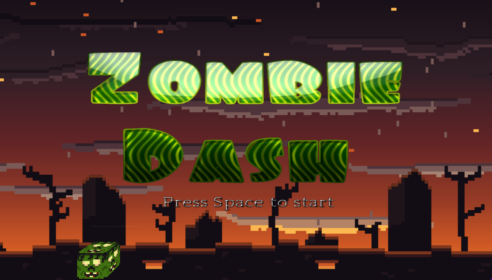
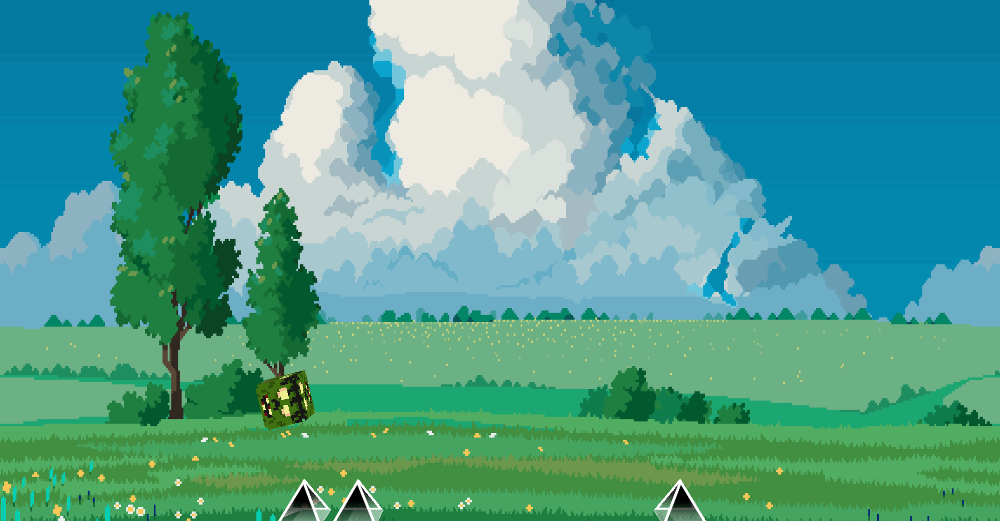

<div align="center">

# RMIV Engine

</div>

**RMIV Engine** is a work-in-progress game engine written in Rust using OpenGL. 


## Disclaimer
> The engine is still under development. Features, systems and structure are all subject to change


## SetUpGuide
There is an example game built with the engine called **Zombie Dash** which you can check out below .
```sh

git clone https://github.com/ItsVoitex/RMIV-ENGINE.git
cd RMIV-ENGINE
# for an optimised release binary 
    cargo build -p ZombieDash --release
# Build the entire workspace:
    cargo build
```


Getting Started

Follow the Setup guide to ensure your development environment is set up correctly. Once set up, you can quickly try out the example by running the commands

```sh
# Run the example
    cargo run -p ZombieDash

```

## Example 1


## Example 2


